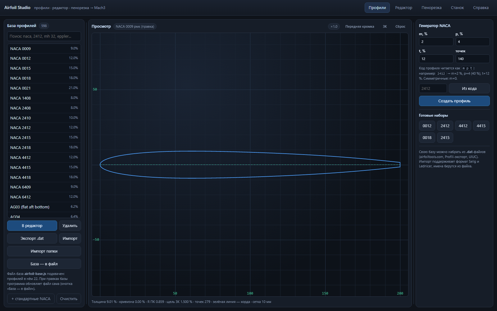
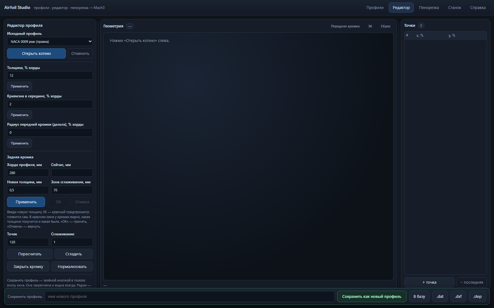
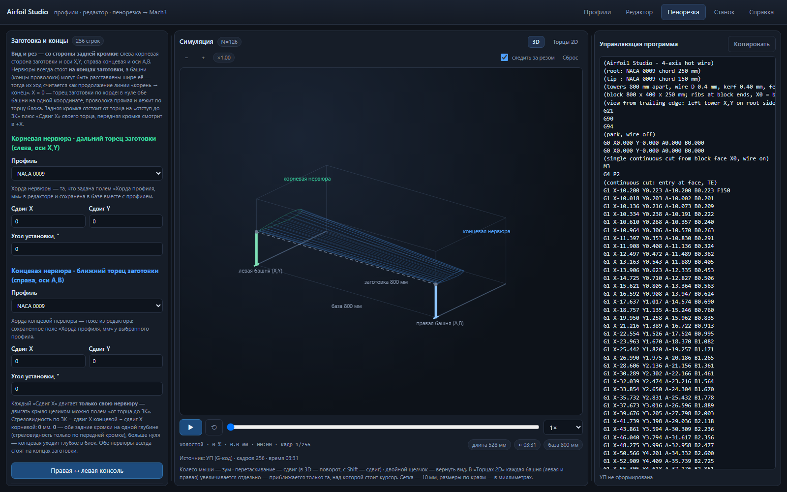
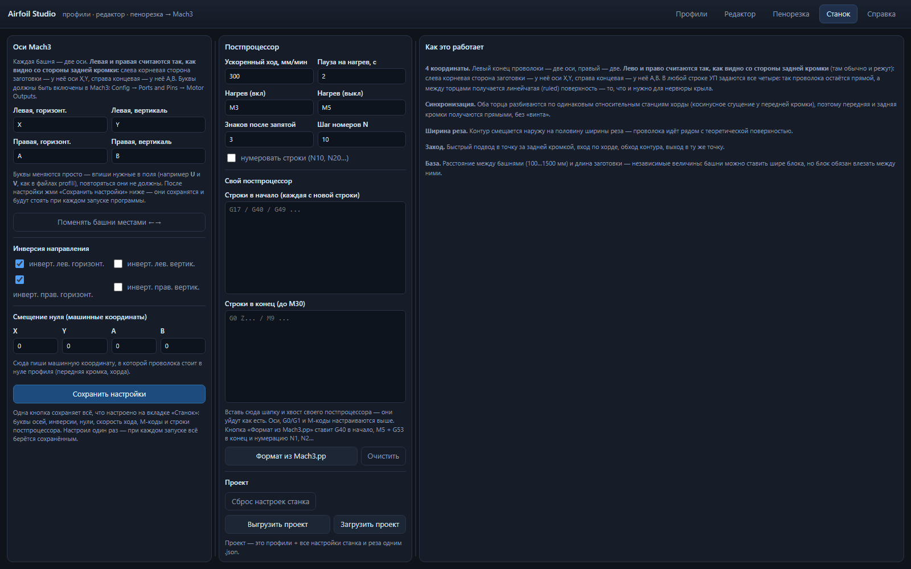
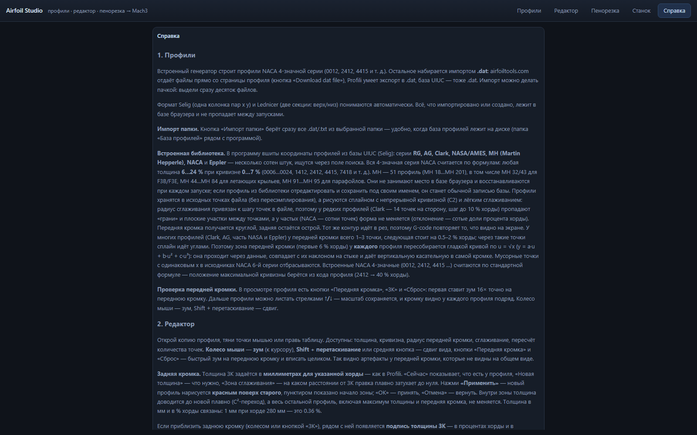

# Airfoil Studio — профили и пенорезка

Программа для **4-осевой пенорезки**: база профилей, редактор профилей и генератор
управляющей программы для Mach3. Две башни тянут горячую нихромовую проволоку —
X/Y на корневой стороне и A/B на концевой, — вырезая крыло с нужной круткой,
стреловидностью и вырезами под лонжероны.

Программа — это **один файл `index.html`**. Открыл двойным щелчком — работаешь:
ни установки, ни сервера, ни интернета, ни сборки.



---

## Как запустить

**Windows 7 и новее.** Двойной щелчок по `index.html` в этой папке. Если браузер
по умолчанию старый (Internet Explorer), щёлкните файл правой кнопкой →
«Открыть с помощью» → Chrome / Edge / Firefox.

**Windows XP.** Сначала один раз установить `XP\Firefox-52.9.0esr-Setup.exe`
(последний браузер, который там работает), потом открыть
`XP\AirfoilStudio-XP.html`. Краткая инструкция для XP лежит рядом:
`XP\Как запустить на Windows XP.txt`.

После обновления файла браузер может показать старую версию из кэша —
нажмите **Ctrl+F5**.

Профили, настройки и раскладка панелей хранятся в браузере (`localStorage`),
поэтому ничего сохранять вручную не нужно. База профилей дополнительно
выгружается в файл `airfoil-base.js` рядом с программой — скопируйте папку
целиком, и на другом компьютере профили подхватятся сами.

---

## Скриншоты

### Профили

База с поиском, превью профиля с зумом до передней кромки и задней кромки,
импорт `.dat` пачкой или целой папкой, экспорт контура.


### Редактор

Правка точек мышью или таблицей: толщина, кривизна, радиус передней кромки,
сглаживание, пересчёт количества точек, толщина задней кромки в миллиметрах.
Сохранение профиля — одной полосой внизу окна.



### Пенорезка

Два торцевых профиля (корень и конец), заготовка, база между башнями,
лонжерон (труба, прямоугольник, два прямоугольника), 3D-превью,
симуляция движения башен и готовый G-код для четырёх осей.



### Пенорезка DXF

Загрузка контура `.dxf` отдельно на каждую башню: слева корневая нервюра
(оси X,Y), справа концевая (оси A,B). Синхронизация держит обе башни на одном
контуре (прямая призма) или позволяет резать крыло с разными нервюрами;
оба контура видно наложенными в миллиметрах — сетка 10 мм. Хорда берётся
из записи профиля, а если DXF в реальных миллиметрах — записывается в профиль
автоматически, по ширине контура в файле.

### Станок

Настройки осей Mach3, скорости быстрых ходов, парковка, формат вывода
(в том числе «Формат из Mach3.pp»). Настройки сохраняются и переживают
перезагрузку страницы.



### Справка

Подробное описание работы — прямо в программе, без отдельных документов.



---

## Что умеет

**Профили**

* Встроенная библиотека нескольких сотен профилей: UIUC (Selig) — серии RG, AG,
  Clark, NASA/AMES, MH (51 профиль, MH 18…MH 201), Eppler.
* Вся 4-значная серия NACA считается по формулам: любая толщина 6…24 %
  при кривизне 0…7 % (0012, 2412, 4415, 7418 и т. д.).
* Импорт `.dat` / `.txt` / `.csv` (форматы Selig и Lednicer разбираются
  автоматически), контуров `.dxf` / `.step` / `.stp`; можно выделить десяток
  файлов сразу или выбрать папку целиком.
* Экспорт контура в `.dat`, `.dxf` (DXF R2000) и `.step` (AP214) — в натуральную
  величину по хорде профиля.

**Редактор**

* Правка точек мышью и таблицей, отмена, зум колесом к курсору.
* Толщина, кривизна, радиус передней кромки, сглаживание, число точек.
* Задняя кромка: толщина задаётся в миллиметрах для указанной хорды, правка
  плавно затухает в заданной зоне, остальной профиль не меняется.
* Хорда профиля в миллиметрах — по ней считаются все выгрузки.

**Пенорезка**

* Расчёт по двум торцевым нервюрам: корень и конец, каждая со своей хордой,
  сдвигом, углом установки и положением лонжерона.
* Кнопка «Правая ↔ левая консоль» меняет профили местами — вырезал одну
  консоль, нажал и режешь вторую той же настройкой.
* Лонжерон режется одним проходом вместе с контуром: труба, прямоугольник,
  два прямоугольника (сверху и снизу, с отступом от обвода).
* Предупреждения, если профиль не влезает в заготовку или заготовка —
  между башнями.
* Управляющая программа: G-код для четырёх осей (Mach3), файл `.tap`,
  симуляция движения башен и 3D-превью.
* Шаблон нервюр 1:1 в PDF — листы A4, книжные или альбомные, с крестиками
  для склейки, вырезами лонжерона пунктиром, засечками 25/50/75 % и контрольной
  линейкой 100 мм.
* Файл проекта (`.json`): профили, хорды, лонжерон, заготовка и рез одной
  детали — можно вернуться к работе позже.

**Пенорезка DXF**

* Загрузка контура `.dxf` на левую и на правую башню — сразу в рез, минуя
  список профилей (но профиль при этом появляется в базе).
* Синхронизация загруженных профилей: включена — что загрузил в одну башню,
  встаёт и в другую; выключена — башни настраиваются отдельно, а кнопки
  «левая → правая» / «правая → левая» переносят контур вручную.
* Оба контура на холсте наложены в натуральную величину: синяя линия —
  левая башня, оранжевая — правая; совпали — лежат друг на друге.
* Хорда DXF в миллиметрах определяется по ширине контура в файле и пишется
  в запись профиля — рез получается нужного размера без ручного ввода.

**Станок**

* Оси Mach3, направления, скорости, быстрый ход, парковка.
* `invLx` / `invRx` включены, быстрый ход 300 мм/мин; в пенорезке отъезд
  назад 0, подача 150 мм/мин.

---

## Из чего состоит папка

```
AirfoilStudio\
├─ index.html          ← сама программа (HTML + CSS + JS, один файл без сборки)
├─ airfoil-base.js     ← файл-база профилей, переносится вместе с программой
├─ XP\                 ← версия для Windows XP
│   ├─ AirfoilStudio-XP.html       ← сборка под Firefox 52 (ES5)
│   ├─ airfoil-base.js             ← запасная копия файл-базы
│   ├─ Firefox-52.9.0esr-Setup.exe ← браузер для XP (в git не входит, 43 МБ)
│   └─ Как запустить на Windows XP.txt
├─ Разработка\         ← документация, история, инструменты сборки
├─ docs\screens\       ← скриншоты для этого README
├─ stabRMK.tap         ← пример управляющей программы
├─ проект рмк стаб .json  ← пример файла проекта
└─ нервюра NACA 0009 1-1\ ← пример шаблона нервюры в PDF (1:1, A4)
```

Документация в `Разработка\`:

| Файл | О чём |
|---|---|
| `ЧИТАТЬ_ПЕРВЫМ.md` | как всё устроено, как продолжить разработку, правила проекта |
| `АРХИТЕКТУРА.md` | карта кода: что в каком месте `index.html`, форматы данных |
| `ИСТОРИЯ.md` | хронология разработки: этапы, решения, ошибки и их причины |
| `БАЗА_ПРОФИЛЕЙ.md` | как хранится база и как она переезжает на другой компьютер |
| `СБОРКА_XP.md` | как из `index.html` получается версия для Windows XP |

---

## Сборка XP-версии

Основная версия должна работать в современном браузере, XP-версия — отдельный
производный файл, который основную не ломает.

Двойной щелчок по `Разработка\инструменты\пересобрать-XP.bat` либо в консоли:

```
powershell -ExecutionPolicy Bypass -File Разработка\инструменты\build_xp.ps1
```

Скрипт извлекает скрипт программы, проверяет синтаксис (`node --check`),
собирает `XP\AirfoilStudio-XP.html` (ES5, совместимость с Firefox 52,
полифилл `flex-gap`) и обновляет запасную копию `airfoil-base.js`.
При ошибке синтаксиса старый файл остаётся целым.

---

## История обновляется сама

`Разработка\инструменты\watch-history.ps1` — маленький «часовой»: через 20 секунд
после последней правки он копирует изменённые файлы в `Разработка\программа\`,
пересобирает XP-версию, делает снимок программы, дописывает запись в
`Разработка\история\ЖУРНАЛ-ИЗМЕНЕНИЙ.md` и не чаще раза в 30 минут обновляет
архив для переноса.

Управление — двойным щелчком в `Разработка\инструменты\`:
`история-состояние.bat`, `история-обновить-сейчас.bat`, `история-выключить.bat`,
`история-включить.bat`, `история-автозапуск.bat`.

---

## Синхронизация с GitHub

Репозиторий: `https://github.com/permyakov344-png/AirfoilStudio` (приватный).

**Автоматически.** В OpenCode достаточно написать задачу обычными словами: после
изменений агент сам делает `commit` → `pull --rebase` → `push`. Отдельно просить
«сохрани» не нужно.

**Раз в неделю.** Задача Windows `AirfoilStudio weekly backup` — понедельник
12:00, даже если OpenCode закрыт. Лог: `..\AirfoilStudio_backups\weekly-backup.log`.

**Вручную.** Двойной щелчок по `tools\sync-now.cmd` (или по старому
`Разработка\инструменты\синхронизация-с-github.bat`):

1. сохраняет изменения (коммит с датой), если они есть;
2. забирает изменения с GitHub (`git pull --rebase`);
3. отправляет обратно (`git push`).

`--force` не используется: история не перезаписывается, ничего не теряется.
Если что-то пошло не так, скрипт остановится и оставит файлы на диске как есть.

В репозиторий **не попадают** (см. `.gitignore`): архив
`AirfoilStudio-Разработка.zip`, установщики `Firefox-*.exe`, `node_modules`,
кэш `_cache` и снимки из `Разработка\история\снимки` — это крупные или
служебные файлы, они собираются локально.

---

## Правила проекта

1. Программа остаётся автономным `index.html` — без CDN, без библиотек в рантайме,
   без сборки и без интернета.
2. Сохранение профиля — только в нижней полосе редактора; поля «хорда» там нет.
3. Слово «носок» в программе не употребляется — только «передняя кромка» / «ПК».
4. Хорда задаётся только в редакторе и живёт в записи профиля.
5. DXF в миллиметрах и в натуральную величину (`$INSUNITS 4`, `$MEASUREMENT 1`).
6. Сетка в «Профилях», «Редакторе» и «Торцах 2D» — шаг 10 мм.
7. Станок: `invLx` / `invRx` включены, быстрый ход 300 мм/мин.
   Пенорезка: отъезд назад 0, подача 150 мм/мин.
8. База профилей живёт в `airfoil-base.js` рядом с программой — одна на обе версии.
9. Правка не должна ломать основную версию ради XP.
10. Интерфейс — по-русски, подписи короткие и человеческие.

---

## Требования

* **Чтобы пользоваться:** любой современный браузер (Chrome, Edge, Firefox).
  Для XP — Firefox 52.9.0esr из папки `XP\`.
* **Чтобы собирать XP-версию:** Node.js 18+. В этой папке зависимости сборщика
  уже установлены (`Разработка\инструменты\node_modules`), интернет не нужен;
  при клонировании репозитория их надо поставить один раз:
  `npm install` в `Разработка\инструменты`.
* **Для вспомогательных скриптов** (например, `dxf_audit.py` — проверка
  выгруженного DXF): Python 3. Не обязательно.

---

## Статус

Рабочий инструмент: программа используется для реальных резов, история правок
и сборка XP-версии автоматизированы. Что ещё стоит проверить руками —
в конце `Разработка\ИСТОРИЯ.md`.
